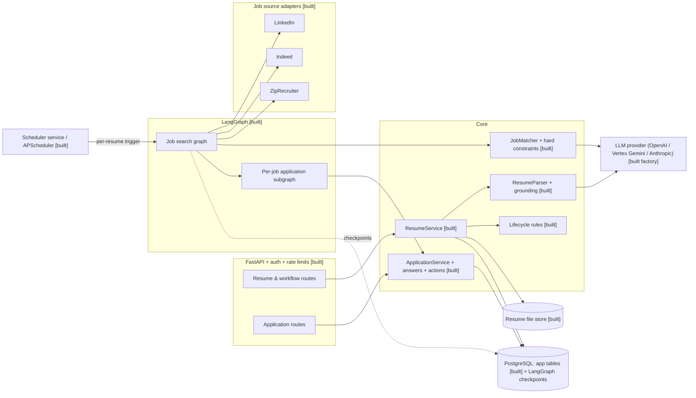
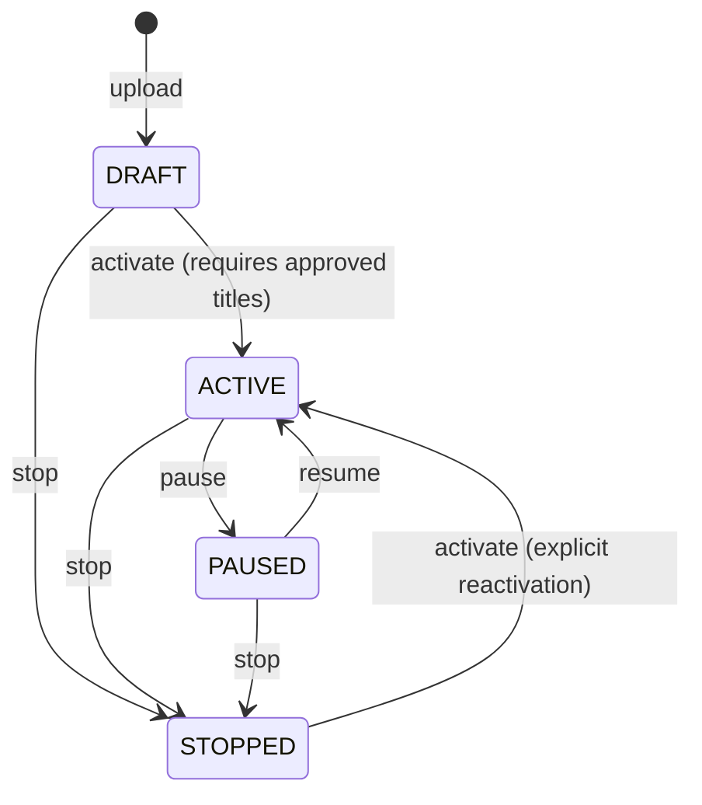
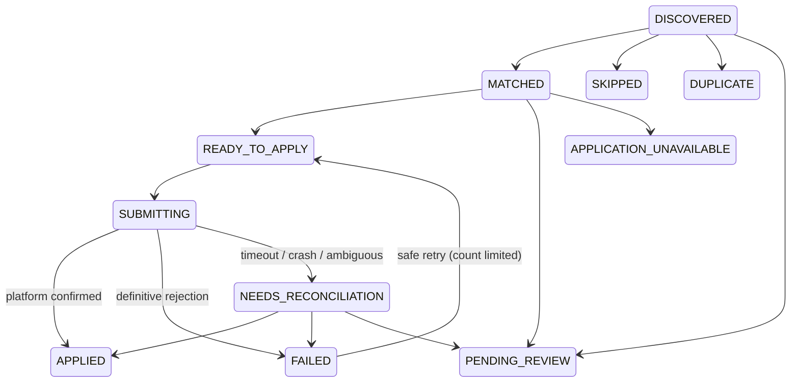
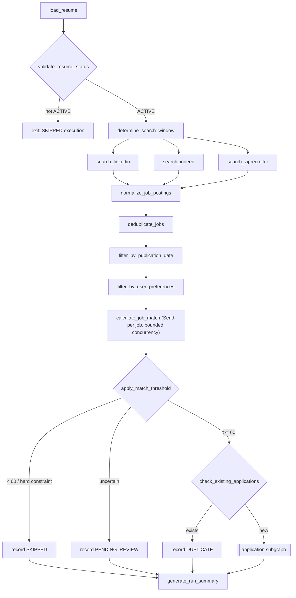
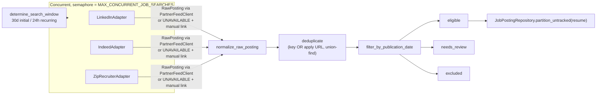
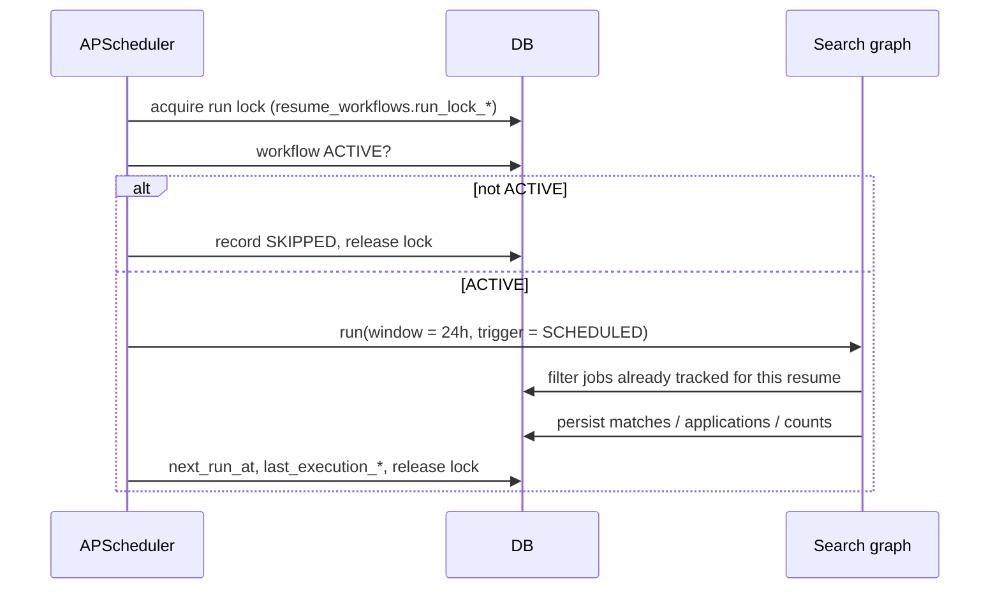
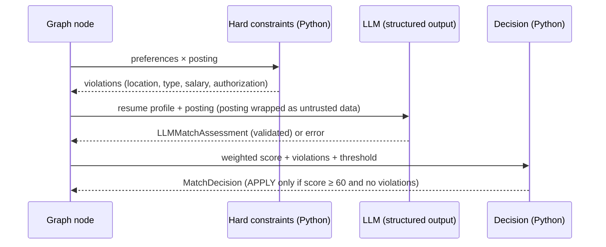

# Architecture

Everything described here is built and tested (Phases 1–7). Requirement-by-requirement evidence is in [acceptance.md](acceptance.md).

## 1. Components



Design rules:

* **Deterministic control, LLM for semantics.** The LLM extracts resume facts and scores fit. Thresholds, hard constraints, lifecycle, deduplication and submission safety are plain Python.
* **The database is the source of truth.** Application history, uniqueness and lifecycle state live in the application tables. LangGraph checkpoints hold only resumable in-flight state.
* **One resume, one context.** Every execution is keyed by `resume_id` (graph thread id = execution id). No state is shared between resumes.
* **Never fabricate.** Parsed profiles pass a grounding filter; adapters leave unknown fields `None`; `APPLIED` requires verified confirmation.

## 2. Data model [built — migration `0001`]

| Table | Purpose | Key constraints |
|---|---|---|
| `users` | account, timezone, preferences | `external_subject` unique |
| `resumes` | stable resume identity, approved preferences | `(user_id, label)` unique |
| `resume_versions` | immutable file + text + parsed profile per upload | `(resume_id, version)` unique |
| `resume_workflows` | lifecycle status, `initial_search_completed`, next run, DB lock | `resume_id` unique, optimistic `row_version` |
| `job_postings` | normalised postings | `(source, external_id)` unique, `canonical_key` indexed |
| `job_matches` | score, criterion scores, evidence, recommendation | `(resume_id, resume_version, job_posting_id)` unique, score 0–100 check |
| `applications` | status machine per resume × job | `application_key` unique, `(resume_id, job_posting_id)` unique |
| `submission_attempts` | durable intent before each external submit | `idempotency_key` unique, **partial unique: one STARTED/UNCERTAIN per application** |
| `approved_answers` | user-approved answers to recurring questions | `(user_id, question_key)` unique |
| `workflow_executions` | run history, window, counts, summary | **partial unique: one RUNNING per resume** |

The resume id is `uuid5(namespace, user_id + sha256(first upload))`, so re-uploading the same file is idempotent. Later uploads add a **version** under the same id. Applications are unique per `resume_id` (not per version), so updating a resume or its preferences cannot create duplicate applications.

### Retention policy

| Data | Default | Mechanism |
|---|---|---|
| Original resume files and extracted text | 365 days after the resume is stopped or deleted (`RESUME_RETENTION_DAYS`) | `resumes.purge_after`. A daily purge job (`services/retention.py`) deletes files, nulls `extracted_text`, and keeps the structured profile only while the resume exists. |
| Application records and attempts | 730 days (`APPLICATION_RETENTION_DAYS`) | `applications.purge_after` |
| Approved sensitive answers | Until the user deletes them | stored per user, never logged |
| Logs | Never contain resume text, answers, tokens, emails or phone numbers | redaction processor in `observability/logging.py` |

## 3. Resume lifecycle [built]



Repeating an action that is already in effect is a no-op. Only `ACTIVE` may search or submit. `DRAFT` is an addition to the specified three states: it represents an uploaded resume that has never been activated, so the first activation can trigger the 30-day initial search.

## 4. Application status machine [built — `models/application.py`]



`NEEDS_RECONCILIATION` extends the specified statuses so an uncertain outcome cannot be confused with `FAILED`, which would invite an unsafe resubmission. `SUBMITTING → READY_TO_APPLY` is deliberately illegal.

## 5. Search graph [built — Phase 4]



The search window is `[now − 30 days, now]` when `initial_search_completed` is false, otherwise `[last_window_end or now − 24h, now]`, capped by the catch-up policy. Postings without a verified publication date are flagged and never auto-applied.

## 5a. Job discovery [built — Phase 2]



| Module | Responsibility |
|---|---|
| `job_sources/base.py` | `PartnerFeedAdapter`: timeout, retry and backoff, `Retry-After`, auth handling, normalization, per-record rejection counts |
| `job_sources/{linkedin,indeed,ziprecruiter}.py` | Source identity, limitation message, manual search URL |
| `job_sources/mock.py` | `StaticFeedClient` for development and tests |
| `services/normalization.py` | HTML cleanup, URL canonicalization, date intervals, arrangement, type, method, salary, years |
| `services/deduplication.py` | Canonical keys, cross-source grouping, representative choice, `application_key` |
| `services/date_filter.py` | Search window and the eligible / review / excluded split |
| `services/job_discovery.py` | Runs all sources concurrently and produces a `DiscoveryReport` with a summary |
| `repositories/jobs.py` | Upserts postings with a stable key and an immutable publication date; per-resume tracked filter |

## 6. Sequence diagrams [built]

### 6.1 Initial search [built — Phases 4–5]

```mermaid
sequenceDiagram
    actor U as User
    participant API
    participant RS as ResumeService
    participant SCH as Scheduler
    participant G as Search graph
    participant DB
    U->>API: POST /resumes/{id}/activate
    API->>RS: change_status(ACTIVATE)
    RS->>DB: workflow DRAFT→ACTIVE
    RS-->>SCH: status listener (activated)
    SCH->>DB: initial_search_completed?
    alt false
        SCH->>G: run(window = 30 days, trigger = INITIAL)
        G->>DB: insert execution RUNNING (unique per resume)
        G->>G: search → dedupe → match → apply
        G->>DB: persist results; execution SUCCEEDED/PARTIAL
        G->>DB: initial_search_completed = true (only after outcome recorded)
    end
    SCH->>SCH: register daily 17:00 America/New_York job (id = resume_id, replace_existing)
```

### 6.2 Recurring search [built — Phase 5]



### 6.3 Matching [built — Phase 3]



### 6.4 Application submission [built — Phases 4 and 6]

```mermaid
sequenceDiagram
    participant AG as Application subgraph
    participant DB
    participant I as Permitted integration
    participant L as LLM
    AG->>DB: stop check (workflow ACTIVE?) else PENDING_REVIEW [stopped]
    AG->>AG: re-check eligibility (APPLY, ≥ threshold, no violations)
    AG->>I: supports(posting)? else APPLICATION_UNAVAILABLE + manual package
    AG->>I: questions(posting)
    AG->>DB: approved answers (only source for sensitive/identity questions)
    opt required job-specific free text
        AG->>L: statements, each quoting resume evidence
        AG->>AG: validate evidence, numbers, sensitive topics, vocabulary
    end
    AG->>DB: answer provenance → submission_evidence; missing → PENDING_REVIEW [missing_answers]
    AG->>DB: stop check again (immediately before the side effect) + per-run cap
    AG->>DB: INSERT submission_attempt STARTED (one open attempt per application), SUBMITTING
    AG->>I: submit(package, idempotency_key)
    alt confirmed with platform reference
        AG->>DB: attempt CONFIRMED, APPLIED, evidence (verification method, ref)
    else definitive rejection
        AG->>DB: attempt REJECTED (retryable flag), FAILED
    else timeout, server error, or "success" without a reference
        AG->>DB: attempt UNCERTAIN, NEEDS_RECONCILIATION
    end
```

### 6.5 Failure recovery [built — Phases 4–6]

```mermaid
sequenceDiagram
    participant S as Scheduler
    participant R as WorkflowRunner
    participant DB
    participant I as Integration
    S->>DB: RUNNING executions whose run lease expired (owner died)
    alt workflow still ACTIVE
        S->>R: resume(execution_id) from PostgreSQL checkpoint
        Note over R: finished steps are not repeated; a submit step that died<br/>mid-call finds its open attempt → NEEDS_RECONCILIATION (never resent)
    else workflow paused/stopped, or no checkpoint
        S->>DB: close execution CANCELLED / FAILED
    end
    loop every RECONCILE_INTERVAL_SECONDS
        S->>DB: NEEDS_RECONCILIATION (due) and stale SUBMITTING applications
        S->>I: lookup(idempotency_key)
        alt FOUND with reference
            S->>DB: APPLIED
        else NOT_FOUND (older than indexing delay)
            S->>DB: FAILED, retryable (user may retry safely)
        else UNKNOWN
            S->>DB: try again later; after RECONCILE_MAX_ATTEMPTS → PENDING_REVIEW [reconciliation]
        end
    end
```

### 6.6 API request [built — Phase 7]

```mermaid
sequenceDiagram
    actor U as Client
    participant A as FastAPI
    participant Auth as Authenticator
    participant DB
    U->>A: Authorization: Bearer token
    A->>Auth: static token (dev) or JWT (signature, exp, iss, aud, sub)
    alt invalid
        A-->>U: 401 (repeated failures per IP → 429)
    else valid
        A->>A: per-user token bucket → 429 + Retry-After
        A->>DB: get-or-create user by subject; every query scoped to user_id
        A-->>U: 2xx, or 404 for other users' resources, 409 / 413 / 422
    end
```
